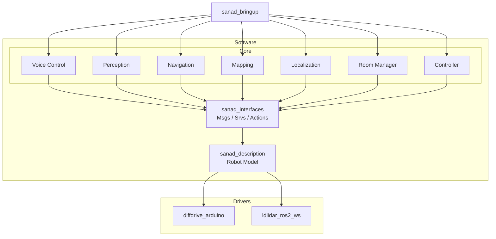

<p align="center">
  
</p>

<h1 align="center">Sanad – AI-Powered Smart Home Robot</h1>

<p align="center">
  <em>An autonomous ROS 2 mobile robot with voice control, vision intelligence, and smart-home integration.</em>
</p>

<p align="center">
  <a href="#features">Features</a> •
  <a href="#system-architecture">Architecture</a> •
  <a href="#prerequisites">Prerequisites</a> •
  <a href="#installation">Installation</a> •
  <a href="#usage">Usage</a> •
  <a href="#packages-overview">Packages</a> •
  <a href="#contributing">Contributing</a> •
  <a href="#license">License</a>
</p>

---

## Features

| Category          | Capabilities                                                                                                                                                              |
| ----------------- | ------------------------------------------------------------------------------------------------------------------------------------------------------------------------- |
| **Voice Control** | Custom wake-word ("Sanad") detection via openWakeWord, speech-to-text (Whisper / Gemini), text-to-speech (Piper / Gemini TTS), and natural-language command understanding |
| **AI Brain**      | Gemini Vertex AI (cloud) or local Koboldcpp LLM for intent parsing, dialogue, and multi-turn conversation in Arabic & English                                             |
| **Vision**        | Real-time object detection (YOLOv8/v11 + ByteTrack), camera-based scene description (Gemini Vision), and visual object navigation                                         |
| **Navigation**    | Autonomous SLAM (slam_toolbox), AMCL localization, Nav2 path planning with a custom global planner, and room-based navigation                                             |
| **Smart Home**    | Room & IoT device management, smart-home device control (lights, AC, TV, heater) per room                                                                                 |
| **Telegram**      | Two-way Telegram bot integration — send and receive messages, read inbox via voice commands                                                                               |
| **Teleoperation** | Keyboard, PS3 controller, IMU-to-twist, and human-following control modes                                                                                                 |
| **Sensor Fusion** | LiDAR + RGBD depth-bias calibration and range-adaptive 2D scan fusion                                                                                                     |

---

## System Architecture

<!-- TODO: Add your system architecture diagram here -->
<!-- <p align="center">
  
</p> -->



---

## Prerequisites

### System Requirements

| Requirement | Version                      |
| ----------- | ---------------------------- |
| **OS**      | Ubuntu 22.04 LTS             |
| **ROS 2**   | Humble Hawksbill             |
| **Gazebo**  | Fortress / Garden (Ignition) |
| **Python**  | 3.10+                        |
| **CMake**   | 3.8+                         |

### Hardware (for Real Robot)

- Differential-drive chassis with Arduino motor controller
- Dual LDLiDAR sensors
- Orbbec Astra Pro / Intel RealSense depth camera (see [`astra_pro_setup_guide.md`](astra_pro_setup_guide.md))
- USB microphone & speaker
- (Optional) PS3 / joystick controller

---

## Installation

### 1. Install ROS 2 Humble

Follow the [official ROS 2 Humble installation guide](https://docs.ros.org/en/humble/Installation/Ubuntu-Install-Debs.html).

### 2. Install Build Tools

```bash
sudo apt update && sudo apt install -y \
  python3-pip python3-colcon-common-extensions python3-rosdep
```

### 3. Clone the Repository

```bash
cd ~
git clone https://github.com/sanadChair/sanad_ws.git
cd sanad_ws
```

### 4. Install ROS Dependencies via rosdep

All ROS package dependencies are declared in the workspace's `package.xml` files.
A single `rosdep install` will resolve and install everything automatically:

```bash
sudo rosdep init   # only needed once on a fresh system
rosdep update
rosdep install --from-paths src --ignore-src -r -y
```

### 5. Install Python Dependencies

```bash
pip install -r requirements.txt
```

### 6. Build the Workspace

```bash
colcon build --symlink-install
source install/setup.bash
```

> **Tip:** Auto-source the workspace for every new terminal:
>
> ```bash
> echo "source ~/sanad_ws/install/setup.bash" >> ~/.bashrc
> source ~/.bashrc
> ```

### 7. Environment Configuration

Copy the example environment file and fill in your API keys:

```bash
cp src/sanad_bringup/.env.example src/sanad_bringup/.env
```

Edit `src/sanad_bringup/.env` with your credentials:

```bash
# Local LLM endpoint (Koboldcpp)
KOBOLD_URL=http://localhost:5001/v1/chat/completions

# Telegram Bot integration
TELEGRAM_BOT_TOKEN=your-telegram-bot-token-here
```

### 8. Google Cloud / Vertex AI Setup (for Cloud AI Mode)

If you plan to use Gemini Vertex AI for LLM or TTS, follow the dedicated guide:

📄 **[`google_cloud_setup.md`](google_cloud_setup.md)**

### 9. Whisper.cpp Setup (for Local STT Mode)

If you plan to use local speech-to-text (`use_cloud:=false`), follow the dedicated guide:

📄 **[`whisper_setup.md`](whisper_setup.md)**

### 10. Camera Setup (Orbbec Astra Pro)

For detailed Orbbec Astra Pro camera setup, refer to the dedicated guide:

📄 **[`astra_pro_setup_guide.md`](astra_pro_setup_guide.md)**

---

## Usage

### Simulation

Launch the full simulated robot stack (Gazebo + RViz + Nav2):

```bash
# Localization mode (default) — uses an existing map
ros2 launch sanad_bringup simulated_robot.launch.py

# Mapping mode — generates a new map with SLAM
ros2 launch sanad_bringup simulated_robot.launch.py use_slam:=true
```

### Real Robot

```bash
ros2 launch sanad_bringup real_robot.launch.py
```

### Voice Control & AI Stack

Launch all voice/AI nodes (wake-word, STT, LLM, TTS, Telegram):

```bash
# Cloud mode (Gemini Vertex AI)
ros2 launch sanad_voice_control commander.launch.py use_cloud:=true

# Local mode (Whisper + Koboldcpp + Piper)
ros2 launch sanad_voice_control commander.launch.py use_cloud:=false
```

### Room Manager & Smart Home

```bash
ros2 launch sanad_room_manager room_manager.launch.py
```

### Teleoperation

```bash
# Keyboard control (simulation — remapped topic)
ros2 run teleop_twist_keyboard teleop_twist_keyboard \
  --ros-args -r /cmd_vel:=/sanad_controller/cmd_vel -p stamped:=true
```

### Console Input (Text-based Commands)

```bash
ros2 run sanad_voice_control console_input_node
```

---

## Packages Overview

### Core Packages

| Package                                       | Type          | Description                                                     |
| --------------------------------------------- | ------------- | --------------------------------------------------------------- |
| [`sanad_bringup`](src/sanad_bringup/)         | `ament_cmake` | Top-level launch files for simulation and real robot deployment |
| [`sanad_description`](src/sanad_description/) | `ament_cmake` | URDF/Xacro robot model, meshes, Gazebo world files              |
| [`sanad_interfaces`](src/sanad_interfaces/)   | `ament_cmake` | Custom ROS 2 message and service definitions                    |

### Intelligence & Voice

| Package                                           | Type           | Description                                                                            |
| ------------------------------------------------- | -------------- | -------------------------------------------------------------------------------------- |
| [`sanad_voice_control`](src/sanad_voice_control/) | `ament_python` | Full AI pipeline — wake-word, STT, LLM brain, TTS, Telegram, and command orchestration |

**Nodes in `sanad_voice_control`:**

| Node                 | Description                                                                                                  |
| -------------------- | ------------------------------------------------------------------------------------------------------------ |
| `wakeup_node`        | Listens for the "Sanad" wake-word using openWakeWord, then captures audio                                    |
| `whisper_node`       | Local speech-to-text using whisper.cpp (offline mode)                                                        |
| `llm_node`           | LLM service — routes queries to Gemini Vertex AI (cloud) or Koboldcpp (local)                                |
| `commander`          | Central orchestrator — parses LLM intent and dispatches navigation, smart-home, vision, and Telegram actions |
| `tts_node`           | Text-to-speech — streams audio via Gemini TTS (cloud) or Piper (local)                                       |
| `telegram_node`      | Telegram bot — polls for incoming messages and sends outgoing messages                                       |
| `console_input_node` | Text-based command input for development/debugging                                                           |

### Navigation & Mapping

| Package                                         | Type          | Description                                                   |
| ----------------------------------------------- | ------------- | ------------------------------------------------------------- |
| [`sanad_navigation`](src/sanad_navigation/)     | `ament_cmake` | Nav2 configuration, behavior trees, and controller parameters |
| [`sanad_mapping`](src/sanad_mapping/)           | `ament_cmake` | SLAM Toolbox configuration and pre-built map files            |
| [`sanad_localization`](src/sanad_localization/) | `ament_cmake` | AMCL and robot_localization (EKF) configuration               |
| [`sanad_planning`](src/sanad_planning/)         | `ament_cmake` | Custom Nav2 global planner plugin (C++)                       |

### Perception

| Package                                     | Type           | Description                                                                                       |
| ------------------------------------------- | -------------- | ------------------------------------------------------------------------------------------------- |
| [`sanad_perception`](src/sanad_perception/) | `ament_python` | Human detection & following (YOLO + ByteTrack), LiDAR–camera sensor fusion, and depth calibration |

### Control & Smart Home

| Package                                           | Type           | Description                                                                                                 |
| ------------------------------------------------- | -------------- | ----------------------------------------------------------------------------------------------------------- |
| [`sanad_controller`](src/sanad_controller/)       | `ament_python` | Twist relay, noisy controller, joystick teleop, and ros2_control configuration                              |
| [`sanad_room_manager`](src/sanad_room_manager/)   | `ament_python` | Room CRUD management, room-based navigation service, smart-home device registry, and room location tracking |
| [`sanad_interface_pkg`](src/sanad_interface_pkg/) | `ament_python` | Keyboard/PS3/IMU-to-twist converters and human-following teleop                                             |

### Hardware Drivers

| Package                                       | Type          | Description                                                          |
| --------------------------------------------- | ------------- | -------------------------------------------------------------------- |
| [`diffdrive_arduino`](src/diffdrive_arduino/) | `ament_cmake` | ros2_control hardware interface for Arduino-based differential drive |
| [`ldlidar_ros2_ws`](src/ldlidar_ros2_ws/)     | `ament_cmake` | LDLiDAR ROS 2 driver                                                 |

---

## Custom Interfaces

### Messages (`sanad_interfaces/msg`)

| Message                  | Description                                |
| ------------------------ | ------------------------------------------ |
| `Room.msg`               | Room data (name, coordinates, devices)     |
| `Device.msg`             | IoT device descriptor (name, type, state)  |
| `TrackedPerson.msg`      | Tracked person bounding box, depth, and ID |
| `TrackedPersonArray.msg` | Array of tracked persons                   |

### Services (`sanad_interfaces/srv`)

| Service                                                                                 | Description                                               |
| --------------------------------------------------------------------------------------- | --------------------------------------------------------- |
| `SpeakToLLM.srv`                                                                        | Send a prompt to the LLM and receive a response           |
| `NavigateToRoom.srv`                                                                    | Navigate to a named room                                  |
| `CaptureAndDescribe.srv`                                                                | Capture a camera frame and describe it via Gemini Vision  |
| `LocateObject.srv`                                                                      | Detect and localize an object in 3D (Gemini + PointCloud) |
| `AddRoom.srv` / `GetRoom.srv` / `GetAllRooms.srv` / `UpdateRoom.srv` / `DeleteRoom.srv` | Room CRUD operations                                      |
| `RegisterDevice.srv` / `DeleteDevice.srv`                                               | Smart-home device management                              |

---

## Workspace Structure

```
sanad_ws/
├── src/
│   ├── sanad_bringup/            # Launch files & environment config
│   ├── sanad_controller/         # Motor control & teleop
│   ├── sanad_description/        # URDF, meshes, Gazebo worlds
│   ├── sanad_interface_pkg/      # Keyboard / PS3 / IMU interfaces
│   ├── sanad_interfaces/         # Custom msgs & srvs
│   ├── sanad_localization/       # AMCL / EKF config
│   ├── sanad_mapping/            # SLAM config & saved maps
│   ├── sanad_navigation/         # Nav2 config & behavior trees
│   ├── sanad_perception/         # YOLO, human follower, sensor fusion
│   ├── sanad_planning/           # Custom global planner plugin
│   ├── sanad_room_manager/       # Room & smart-home management
│   ├── sanad_voice_control/      # Voice AI pipeline
│   ├── diffdrive_arduino/        # Arduino hardware interface
│   └── ldlidar_ros2_ws/          # LDLiDAR driver
├── requirements.txt              # Python pip dependencies
├── astra_pro_setup_guide.md      # Orbbec camera setup guide
├── google_cloud_setup.md         # Vertex AI / Gemini cloud setup
├── whisper_setup.md              # whisper.cpp local STT setup
├── LICENSE                       # MIT License
└── README.md
```

---

## Development Notes

- **Add a new ROS 2 package:**

  ```bash
  cd ~/sanad_ws/src
  ros2 pkg create --build-type ament_cmake <pkg_name>
  # or for Python packages:
  ros2 pkg create --build-type ament_python <pkg_name>
  ```

- **Build a single package (fast iteration):**

  ```bash
  colcon build --packages-select <pkg_name> --symlink-install
  ```

- **Run tests:**
  ```bash
  colcon test --packages-select <pkg_name>
  colcon test-result --verbose
  ```

---

## Contributing

1. Fork the repository
2. Create a feature branch: `git checkout -b feature/your-feature`
3. Commit your changes: `git commit -am 'Add new feature'`
4. Push to your fork: `git push origin feature/your-feature`
5. Open a Pull Request

---

## Sensor-to-Software Mapping

| Sensor / Input | ROS 2 Package              | Published Topics                        | Msg Type                | Purpose                       |
| -------------- | -------------------------- | --------------------------------------- | ----------------------- | ----------------------------- |
| Keyboard       | `sanad_interface_pkg`      | `/cmd_vel`                              | `geometry_msgs/Twist`   | Manual velocity control       |
| PS3 Controller | `sanad_interface_pkg`      | `/cmd_vel`                              | `geometry_msgs/Twist`   | Joystick teleoperation        |
| LDLiDAR (×2)   | `ldlidar_ros2_ws`          | `/scan`, `/scan_2`                      | `sensor_msgs/LaserScan` | 2D obstacle detection & SLAM  |
| Depth Camera   | `astra_camera` / RealSense | `/realsense/image`, `/realsense/points` | `Image`, `PointCloud2`  | Vision, depth sensing, fusion |
| Microphone     | `sanad_voice_control`      | `/robot/voice_command`                  | `std_msgs/String`       | Voice command input           |
| Telegram Bot   | `sanad_voice_control`      | `/robot/telegram/send`                  | `std_msgs/String`       | Remote messaging              |

---

## License

This project is licensed under the **MIT License** — see the [LICENSE](LICENSE) file for details.

Copyright © 2026 **SANAD TEAM**

---

<p align="center">
  
  <br/>
  <strong>Built with ❤️ by Sanad Team</strong>
</p>
